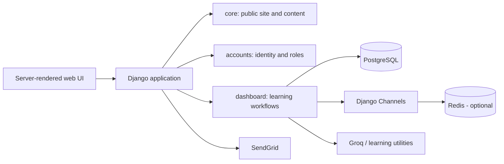

# AbacusMaster

A role-based learning management platform for students, teachers, and parents, built with Django, PostgreSQL, Channels, and optional AI-assisted learning workflows.

AbacusMaster brings course delivery, assessments, attendance, communication, and performance analytics into one application. The project is designed around explicit role boundaries: students learn and submit work, teachers manage instruction and evaluation, and parents follow a linked child's progress.

## Product capabilities

### Students

- Browse subjects, chapters, notes, and learning resources
- Complete assignments, exams, and generated practice questions
- Review remarks, responses, attendance, holidays, and performance graphs
- Use a virtual abacus and AI-assisted learning tools
- Download answer and exam reports as PDFs

### Teachers

- Manage sections, subjects, chapters, resources, and student records
- Create assignments and exams, grade submissions, and publish remarks
- Record attendance and class messages
- Export student records to CSV
- Organize groups and competitions
- View dashboard metrics and students who may need intervention

### Parents

- Link and switch between children
- Review assignments, notes, announcements, holidays, and exam portions
- Follow performance data and teacher communication
- Request simplified explanations of assignments and remarks

### Platform

- Custom email-based user model with student, teacher, and parent roles
- Centralized section-, student-, and subject-level access control
- Real-time notifications through Django Channels
- PostgreSQL persistence with optional Redis cache and channel layer
- Multilingual configuration for English, Hindi, Tamil, Odia, Punjabi, and Bengali
- SendGrid email delivery and optional Groq-powered learning utilities

## Architecture



The codebase is divided into three Django apps:

- `core/` — public pages, blog, contact, newsletter, and shared templates
- `accounts/` — custom users, profiles, sections, authentication, and teacher assignments
- `dashboard/` — courses, exams, submissions, analytics, notifications, and role dashboards

For a feature-by-feature code index, see [`FEATURE_MAP.md`](FEATURE_MAP.md).

## Technology stack

| Area | Technology |
| --- | --- |
| Application | Python, Django 5 |
| Database | PostgreSQL |
| Realtime | Django Channels, Daphne, optional Redis |
| UI | Django templates, HTML, CSS, JavaScript |
| Documents | ReportLab, Pillow |
| AI utilities | Groq-compatible API integration, optional media/transcript tooling |
| Email | SendGrid SMTP |

## Local development

### Prerequisites

- Python 3.11+
- PostgreSQL
- Redis only when testing the production-style channel layer or cache

### 1. Clone and install

```bash
git clone https://github.com/Sandeshkumar0/abacus.git
cd abacus
python -m venv .venv
source .venv/bin/activate  # Windows: .venv\Scripts\activate
pip install -r requirements.txt
```

### 2. Configure the environment

Create a `.env` file in the repository root:

```dotenv
DJANGO_SECRET_KEY=replace-with-a-long-random-value
DJANGO_DEBUG=True

DB_NAME=abacus
DB_USER=postgres
DB_PASSWORD=postgres
DB_HOST=127.0.0.1
DB_PORT=5432

# Optional integrations
GROQ_API_KEY=
GROQ_MODEL=llama-3.3-70b-versatile
SENDGRID_API_KEY=
DEFAULT_FROM_EMAIL=AbacusMaster <noreply@example.com>
FRANCHISE_NOTIFY_EMAIL=admin@example.com
```

For Redis-backed realtime events in a deployed environment:

```dotenv
CHANNEL_LAYER_BACKEND=channels_redis.core.RedisChannelLayer
REDIS_HOST=127.0.0.1
REDIS_PORT=6379
USE_REDIS_CACHE=True
REDIS_URL=redis://127.0.0.1:6379/1
```

Never commit a real `.env` file or provider credentials.

### 3. Initialize and run

```bash
python manage.py migrate
python manage.py createsuperuser
python manage.py runserver
```

Open `http://127.0.0.1:8000`.

For the ASGI server used by Channels:

```bash
daphne -b 0.0.0.0 -p 8000 abacus_site.asgi:application
```

## Engineering notes

- Access rules are centralized in `dashboard/access_control.py` and role decorators, instead of being repeated across templates.
- Dashboard metrics live in `dashboard/services/dashboard_metrics.py` and are exposed through focused snapshot APIs.
- Notifications are generated by model signals and delivered through the Channels consumer.
- AI integrations are optional. Core learning, assessment, and reporting flows should remain usable without an API key.
- Local development uses an in-memory channel layer and local-memory cache unless Redis is explicitly enabled.

## Validation

Before opening a pull request, run:

```bash
python manage.py check
python manage.py makemigrations --check --dry-run
python manage.py test
```

The repository currently needs broader automated coverage. Priority areas are role authorization, cross-section data isolation, grading transitions, notification delivery, and parent-child access.

## Production checklist

- Set `DJANGO_DEBUG=False` and use a unique secret key
- Configure deployment hosts, CSRF origins, and secure cookies
- Use managed PostgreSQL and Redis services
- Run migrations during deployment
- Serve static/media files through dedicated storage or a reverse proxy
- Configure SendGrid sender verification
- Store every credential in the deployment platform's secret manager

## Roadmap

- Expand authorization and workflow integration tests
- Add auditable grade and attendance history
- Add intervention workflows for at-risk students
- Provide OpenAPI documentation for dashboard endpoints
- Containerize the application and add CI checks
- Add accessible, exportable parent progress reports

## License

No license has been declared yet. Add a license before accepting external contributions or reuse.
